# Roadmap
Detalhe operacional (tarefas, ficheiros, testes) em `IMPLEMENTATION-PLAN.md`. Resumo:

```mermaid
gantt
  dateFormat X
  axisFormat %s
  section Fundação
  1 Raiz e arquitetura :0,1
  2 Projeto Unity :1,2
  3 Config mobile :2,3
  section Núcleo
  4 Conta/Auth :3,4
  5 Personagem :4,5
  6 Movimento :5,6
  7 Bairro Luanda :6,7
  section Multiplayer
  8 Multiplayer :7,8
  9 Chat :8,9
  10 Nascimento :9,10
  section Sistemas
  11-17 Interações a Relações :10,17
  section Expansão
  18-22 Voz a Lançamento :17,22
```

Reordenação proposta face ao pedido: manter a ordem original; **spikes de custo/limites** (Fusion/PlayFab) na Fase 2–4 antes de comprometer a stack (ADR-0001/0002).
