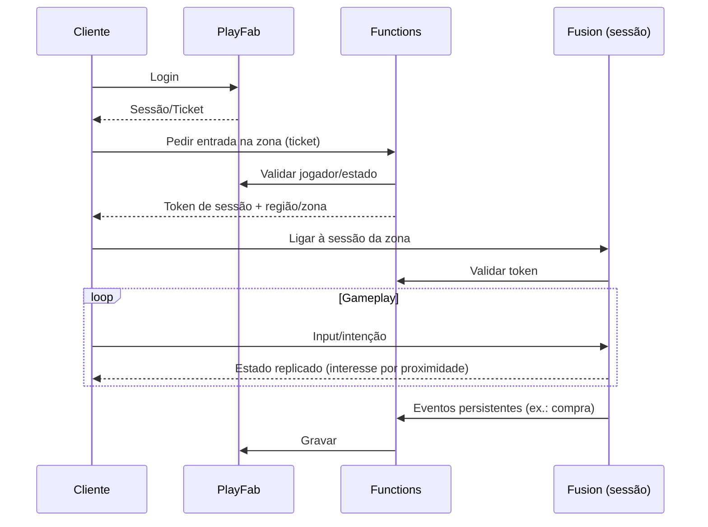

# Arquitetura Multiplayer

## Decisões
- **Sessão por zona/instância** (shard), com limite inicial pequeno e testes progressivos.
- **Area of Interest:** replicar apenas jogadores/objetos próximos; taxa de atualização adaptativa.
- **Modo:** servidor autoritativo (Fusion Server/dedicado) para economia e combate; Shared mode só se justificado em ADR.
- **Reconexão:** estado de personagem recuperado do backend.
- **Dados móveis:** compressão, quantização de posições, delta updates.

## Riscos
CCU e custos, anti-batota em modo partilhado, sincronização de veículos, latência regional.
## Critérios de conclusão (Fase 8)
2+ clientes em Android/iOS reais na mesma zona, movimento sincronizado, medições de largura de banda registadas.
