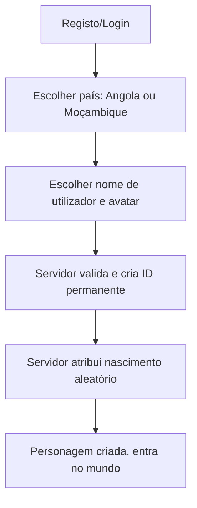

# Sistema de Personagem
## Fluxo de criação

## Dados da personagem
ID permanente (imutável), nome de utilizador (regras e unicidade), país, origem (província/cidade/bairro — imutável), aparência, roupa, calçado, acessórios, estatuto.
## Avatar
Corpo modular (malha base + blendshapes para rosto/corpo), cabelo/roupa como peças intercambiáveis (Addressables), limite de materiais por personagem para desempenho mobile; animações com retargeting humanoide.
## Identificação
Nome/ID sobre a cabeça com distância máxima e agrupamento para poupar render.
## Validações
Nome: tamanho, caracteres, filtro de ofensas; pedidos repetidos idempotentes.
## Riscos
Custo de produção de peças, memória com muitos avatares, equidade e diversidade na personalização.
## Conclusão (Fase 5)
Criar, gravar, carregar e replicar aparência; origem não editável pelo cliente.
