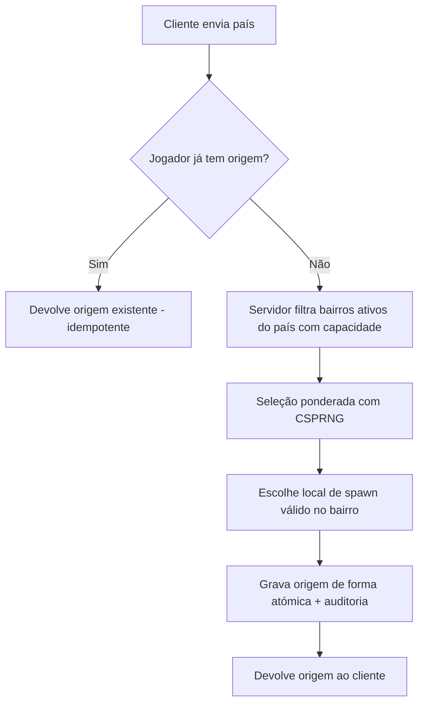

# Nascimento Aleatório
O jogador escolhe **apenas o país**. O servidor atribui província, cidade, bairro e local inicial. A origem é **permanente**.

## Algoritmo
1. Candidatos: bairros `active=true` do país com ocupação < `capacity_cap`.
2. Peso = `birth_weight` × fator de equilíbrio (favorece bairros sub-povoados).
3. Escolha com gerador criptograficamente seguro no servidor; semente nunca no cliente.
4. Spawn: ponto aleatório entre `spawn_points` do bairro (validados offline).
5. Gravação atómica com restrição de unicidade por jogador.
## Regras
Origem não pode ser comprada, trocada ou escolhida. Mudança de residência = viajar (ver `TRANSPORT-AND-TRAVEL.md`).
## Segurança
Sem retry que gere nova origem; log de auditoria; teste estatístico de distribuição.
## Riscos
Poucos bairros no início (distribuição concentrada no vertical slice); percepção de justiça.
## Conclusão (Fase 10)
Testes estatísticos de distribuição, idempotência e concorrência passam.
