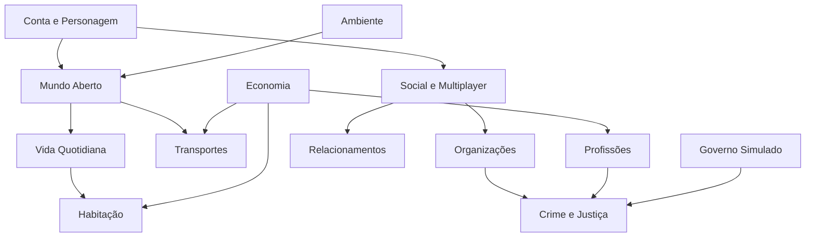

# Módulos do Sistema

| Módulo | Responsabilidade | Autoridade | Depende de |
|---|---|---|---|
| A Conta/Personagem | Auth, perfil, avatar | Backend | — |
| B Mundo | Movimento, zonas, interiores | Servidor de sessão | A |
| C Vida | Necessidades, saúde | Servidor de sessão + backend | B, F |
| D Habitação | Arrendar/comprar/decorar | Backend | F, A |
| E Transportes | Veículos, viagens | Servidor + backend | B, F |
| F Economia | Moedas, bancos, transações | Backend | A |
| G Profissões | Empregos, salários | Backend | F |
| H Social | Chat, voz, amigos, moderação | Serviços de chat/voz + backend | A |
| I Relacionamentos | Namoro, família | Backend | H |
| J Organizações | Grupos, territórios | Backend | H |
| K Crime/Justiça | Missões, polícia, prisão | Servidor + backend | G, J |
| L Governo | Eleições virtuais | Backend | J |
| M Ambiente | Clima, ciclo dia/noite, eventos | Servidor de sessão | B |

Regra: módulos comunicam por interfaces/eventos definidos; sem acesso direto a dados de outro módulo. Cada módulo = Assembly Definition no cliente e serviço/função separado no backend.
