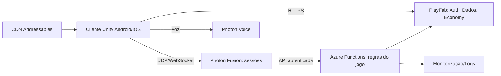

# Arquitetura Técnica
## Visão geral

## Princípios
1. **Servidor autoritativo:** o cliente envia intenções, nunca resultados.
2. **Uma fonte de verdade** para dados persistentes (PlayFab) — sem duplicação.
3. **Modularidade:** módulos com contratos claros (ver `SYSTEM-MODULES.md`).
4. **Idempotência:** operações económicas com `transaction_id` único.
5. **Observabilidade:** logs estruturados e auditoria de economia.
6. **Escala por medição:** começar com instâncias pequenas (ex.: 8–16 jogadores/zona) e subir com testes.

## Responsabilidades
| Pergunta | Resposta |
|---|---|
| Quem autentica? | PlayFab |
| Quem guarda dados? | PlayFab (fonte única) |
| Quem controla sessões? | Fusion (Server mode a avaliar) |
| Quem valida economia/inventário/propriedades? | Azure Functions + PlayFab Economy |
| Quem valida movimento/ações? | Servidor de sessão |
| Como comunicam? | HTTPS autenticado (ticket de sessão) entre serviços |

## Camadas do cliente
`Presentation (UI)` → `Application (casos de uso)` → `Domain (regras locais, previsão)` → `Infrastructure (rede, serviços)`. Cliente prevê, servidor corrige.

## Riscos
Lock-in PlayFab/Photon; custos por CCU; limites de API; latência em África (região de servidores — avaliar África do Sul/Europa); modelos de dados difíceis de migrar.

## Critérios de conclusão (Fase 1)
Arquitetura documentada, ADRs propostos, validação prática adiada para spikes das Fases 2–4.
