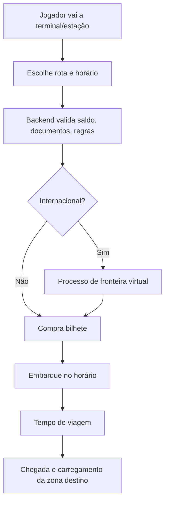

# Transportes e Viagens
## Modos
Carros, motas, táxis, autocarros, comboios (onde existam), barcos, aviões; terminais e aeroportos.
## Viagem entre regiões

## Elementos
Bilhete (dinheiro virtual, validade, horário), rotas e horários (dados), documentação virtual, fronteira (Angola↔Moçambique), tempo de viagem (pode ser acelerado/cutscene) com carregamento por zonas durante a viagem.
## Veículos
Propriedade validada no backend; física simplificada e replicação com interpolação; personalização cosmética.
## Riscos
Sincronização de veículos, streaming de zonas durante viagem rápida, equilíbrio do tempo de viagem.
## Conclusão (Fase 12)
Viagem completa dentro de uma cidade e uma viagem inter-regional protótipo com bilhete validado.
